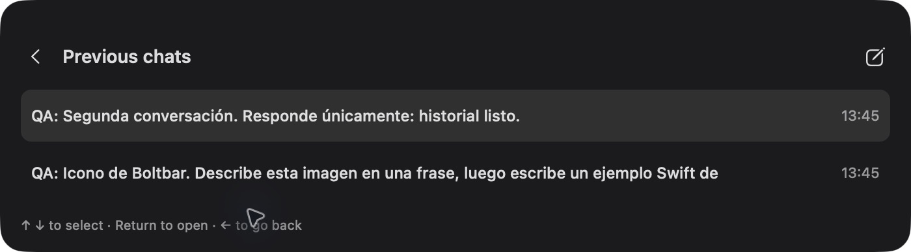
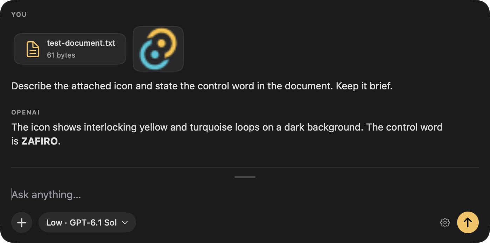

# Boltbar: QA en macOS y sustitución por Swift

Pruebas del 14 de octubre de 2026, MacBook Pro M1 Pro, macOS 27.0 (26A428), pantalla integrada. Xcode/Swift 6.4. La release original fue v0.1.3. Tras la primera comparación, el propietario pidió sustituir Tauri por Swift y cambiar el icono; esa es la implementación propuesta en `swift-spike`. `mac-qa` conserva la investigación anterior.

PR de la migración y correcciones: [#1](https://github.com/juanluisrto/boltbar/pull/1). Abierto para revisión, sin merge ni release.

## Resultado

La implementación nueva usa SwiftUI, `NSPanel`, `NSTextView`, Carbon, Security.framework y URLSession. No ejecuta React, Rust, Tauri ni WebKit. El editor parte de una línea (26 pt), crece hasta 160 pt y después hace scroll. Los adjuntos pertenecen al mensaje enviado: permanecen visibles y se incluyen en los siguientes turnos. Se mueve arrastrando el fondo libre. Los cuatro bordes redimensionan un eje y las cuatro esquinas ambos, sin tiradores visibles. El historial se abre dentro de la barra, con selección gris, títulos, fechas y navegación con ↑/↓, Return y ←. El chip muestra modelo y gauge de esfuerzo; Settings queda en ⌘, y en el menú. El icono es un rayo ámbar propio.

## Matriz de pruebas

OK significa observado en este Mac; FALLA indica un defecto reproducido. PARCIAL distingue lo implementado o probado por transporte de lo que aún no tiene prueba real. NP significa no probado. Las capturas son estados, no mediciones de latencia.

| Funcionalidad | Release v0.1.3 | Swift | Evidencia |
|---|---|---|---|
| Barra oscura, opaca, esquinas y botones completos | OK en la captura; demasiado espacio de escritura para el uso esperado | OK, editor de una línea | [Antes](screenshots/release-01-bar.jpg), [después](screenshots/native-22-gauge-chip.jpg) |
| ⌥ Espacio abre una conversación vacía; Esc oculta | Atajo físico confirmado por el propietario en Tauri corregido, no en la release original | OK, confirmado físicamente por el propietario; registro Carbon `noErr` | [Barra vacía](screenshots/native-22-gauge-chip.jpg); confirmación manual registrada durante la sesión |
| Texto largo crece y después hace scroll | OK | OK; corregido un recorte horizontal descubierto en la primera versión nativa | [Release](screenshots/release-09-long-input.jpg), [fallo nativo inicial](screenshots/native-before-long-input-clipped.jpg), [corrección](screenshots/native-05-long-input.jpg) |
| Mover y redimensionar la barra | NP en release | Defecto comunicado por el propietario; controles AppKit añadidos y probados mediante arrastre | [Redimensionada](screenshots/native-08-manual-resize.jpg), geometría en `metrics.json` |
| Selector de archivos: imagen y documento; quitar con ✕ | OK | OK: selector, pegado de imagen desde Preview y botón ✕ | [Release](screenshots/release-10-attachments.jpg), [quitar en release](screenshots/release-11-removed.jpg), [pegado nativo](screenshots/native-13-pasted-image.jpg), [quitar en Swift](screenshots/native-14-removed-image.jpg) |
| Miniatura después de enviar y contexto en siguientes turnos | FALLA: el adjunto desaparecía del historial visual | OK, respuesta real identificó la imagen y la palabra de control del documento; segundo turno completado | [Mensaje enviado](screenshots/native-03-attachments-sent.jpg), [siguiente turno](screenshots/native-04-attachment-followup.jpg); test de payload histórico |
| Pegar imágenes y soltar archivos | PARCIAL: selector probado, ruta de drop corregida en código | Pegado OK; drop implementado sin prueba visual concluyente | [Imagen pegada](screenshots/native-13-pasted-image.jpg); no se equipara pegar a soltar archivos |
| Popover con esfuerzo y modelos | FALLA: recorte del popover y esfuerzo inaccesible | OK: gauge de ancho fijo; exactamente Astra, Sol y Luna en el catálogo OpenAI actual | [Antes](screenshots/release-02-models.jpg), [Tauri corregido](screenshots/fixed-02-models.jpg), [catálogo nativo](screenshots/native-16-models-curated.jpg), [chip final](screenshots/native-22-gauge-chip.jpg). La captura por ventana recorta la parte del popover que queda fuera de ella |
| OpenAI: respuesta y streaming real | OK | OK, 79 deltas en la prueba numérica; imágenes y texto probados | [Release](screenshots/release-07-openai.jpg), [Swift con imagen](screenshots/native-03-attachments-sent.jpg), `metrics.json` |
| Claude Code con login existente | FALLA: contrato CLI incompatible, sin respuesta | OK por transporte; también se observó conversación real del propietario en la UI, que no se publica | [Fallo original](screenshots/release-08-anthropic.jpg), `metrics.json` |
| Codex CLI con login existente | Una respuesta completa, sin deltas por token | PARCIAL: respuesta real; `codex exec --json` entrega eventos de mensaje completo | `metrics.json`; no se presenta como streaming token a token |
| Cursor | FALLA por falta de sesión autenticada en este Mac | NP para llamadas reales: CLI instalado sin login válido | [Estado original](screenshots/release-12-cursor.jpg), [Settings nativo](screenshots/native-07-settings-bottom.jpg) |
| Markdown y código coloreado | OK con respuesta Demo | OK, respuesta real sintética con bloque Swift coloreado | [Release](screenshots/release-06-markdown.jpg), [Swift](screenshots/native-15-markdown-image.jpg); tests de bloques incompletos |
| Settings separado con ⌘,; todas sus secciones accesibles | Ventana OK; FALLA al llegar a proveedores inferiores | OK, ventana separada y scroll completo | [Antes](screenshots/release-04-settings-scroll.jpg), [arriba](screenshots/native-06-settings-top.jpg), [abajo](screenshots/native-07-settings-bottom.jpg) |
| Llavero `com.boltbar.keys`, sin keys en configuración | Escritura/lectura verificadas después de corregir Tauri | Lectura OK sin variable de entorno, tras autorización manual del propietario; escritura implementada, prueba UI nativa pendiente | [Guardado Tauri](screenshots/fixed-03-keychain.jpg), llamada nativa real y comprobación de preferencias |
| Historial persistente, títulos, fechas y teclado | No disponible | OK: reapertura después de reiniciar, imagen conservada, clic y ↑/↓ + Return; ← vuelve al chat | [Listado](screenshots/native-23-inline-history.jpg), [selección](screenshots/native-24-history-keyboard.jpg), [reinicio](screenshots/native-19-history-after-restart.jpg), [← conserva borrador](screenshots/native-25-left-restores-draft.jpg) |
| Modo claro y oscuro del sistema | NP | OK: panel oscuro en ambos; se restauró el modo claro original | [Claro](screenshots/native-20-system-light.jpg), [oscuro](screenshots/native-21-system-dark.jpg) |

## Fallos y cambios

Los commits de `mac-qa` separan las correcciones anteriores a la decisión de abandonar Tauri:

| Commit | Fallo y corrección |
|---|---|
| `6847172` | La compilación local de Rust en macOS 27 rompía las bibliotecas de proc macros al aplicar stripping. Se conserva su información de compilación. |
| `385c634` | Errores del Llavero ocultos y CLIs no encontrados al lanzar desde GUI. Se propagan los errores y se resuelven rutas habituales de instalación. |
| `31b0022` | Claude necesitaba `--verbose` y eventos parciales; se drenaban mal los pipes. Corregidos CLI, framing SSE, cancelación y catálogo filtrado. |
| `c5c5632` | Popover recortado, Settings sin scroll útil, sincronización, tamaño y ciclo de nueva conversación. Corregidos panel, permisos de archivos y estado. |
| `175ac87` | El instalador reemplazaba la app y eliminaba cuarentena. Ahora conserva la instalación anterior y sus metadatos. |

Estas correcciones quedan como archivo de la investigación; la propuesta actual elimina la pila Tauri. En Swift se corrigieron además: delimitación SSE (las líneas vacías son significativas), adjuntos perdidos al vaciar el borrador, respuestas tardías tras nueva conversación, editor vacío sin área clicable, desplazamiento horizontal al pegar texto largo y arrastre de ventana/redimensionado. El propietario confirmó el atajo nativo físicamente.

## Modelos e historial

El selector OpenAI aplica una política explícita: las familias Astra, Sol y Luna. De cada una elige el alias estable con la versión numérica más alta que devuelve `/v1/models`; excluye snapshots fechados, previews y variantes especializadas. Actualmente ofrece `gpt-6-astra`, `gpt-6.1-sol` y `gpt-6-luna`. Refresca al arrancar, cada seis horas y bajo demanda en Settings. Conserva el último catálogo correcto si la consulta falla. La API no tiene una etiqueta de calidad "flagship": nuevas versiones dentro de estas familias entran automáticamente; una familia nueva requiere actualizar la política. Sin API y sin caché previa, CLI usa las tres opciones incluidas en la app, con ese límite indicado en Settings.

Los chats y sus adjuntos se guardan en `~/Library/Application Support/Boltbar/Conversations`, con directorio 0700 y archivos 0600. La lista carga solo el índice; el contenido se lee al abrir un chat. Las keys siguen exclusivamente en el Llavero o en el entorno de arranque, sin incluirse en el historial. No hay sincronización de chats en nube. No se pueden recuperar las conversaciones de builds anteriores que solo las mantenían en memoria.

## Rendimiento y método

Prompt fijo: números del 1 al 40, `gpt-6.1-sol`, esfuerzo Low, misma máquina. TTFT se mide desde invocar el transporte hasta recibir el primer fragmento de texto. Las llamadas son secuenciales y no constituyen un ensayo aleatorizado; la red y el proveedor dominan esta medida.

| Medida | Tauri corregido | Spike Swift mínimo | App Swift |
|---|---:|---:|---:|
| Huella física en reposo, sin conversación ni Settings | 94,3 MiB, suma de app + GPU + WebContent + Networking | 20,9 MiB | 22,7 MiB en la build final con índice de historial (22,6 inicial; 23,3 en una build intermedia) |
| TTFT OpenAI, mediana de 3 | 1.595 ms | 1.533 ms | 2.065 ms |
| Rango TTFT OpenAI | 1.316–1.717 ms | 1.482–1.754 ms | 1.317–2.092 ms |
| Primeras 5 reaperturas, mediana del callback interno | 1,22 ms | 1,27 ms | Muestras internas en `metrics.json`; no comparables con pulsación física |

La app Swift completa usó aproximadamente un **76 % menos de huella física** que la build Tauri limpia. Es una observación de una sesión, no una garantía para todas las conversaciones. No se compara RSS con huella física. La release original después de chat/Settings tenía aproximadamente 129,6 MiB en cuatro procesos identificados; un quinto WebContent añadía 18,6 MiB pero su atribución a Settings no quedó demostrada, por lo que no se usa en la comparación limpia.

En otros transportes, una llamada nativa Claude Code tuvo TTFT 3.328 ms, 10 deltas y 5.702 ms totales. Codex CLI tuvo 6.656 ms hasta su único evento de texto y 9.218 ms totales. No son medidas del mismo modelo ni del mismo protocolo.

**Límite de la apertura:** los callbacks no miden pulsación física → píxeles. El de Tauri termina después de mostrar/enfocar la ventana; el de Swift incluye layout nativo. No son métricas equivalentes y no demuestran una ventaja de Swift en latencia perceptible. Computer Use no despacha de forma fiable el atajo global; la comprobación física la realizó el propietario. No se inventa un tiempo end-to-end.

## Recomendación

Continuar con Swift para esta app exclusivamente macOS. La reducción de memoria observada es clara y el control directo de NSPanel, editor, menús y Llavero permite resolver los problemas concretos sin coordinar una vista web con una ventana Rust. La mejora demostrada es memoria y control visual; **las llamadas al modelo no son más rápidas por reescribir la UI**.

El coste es mantener el renderizador Markdown nativo, integración de CLIs y pruebas de geometría/AppKit. No se ha medido mantenimiento a largo plazo. El spike mínimo era mucho menor que una app completa: no se extrapola su tamaño o complejidad a toda la migración. La nueva implementación no añade dependencias Swift externas, pero su resaltado es básico y no presenta tablas GFM completas.

## Distribución y límites pendientes

Se ha compilado un binario universal arm64 + x86_64. Solo arm64 se ha ejecutado en hardware. La firma local utiliza un certificado Apple Development existente; **no es una distribución notarizada**. La release original tenía firma ad hoc, sin Team ID, y Gatekeeper rechazó su evaluación. El instalador original quitaba la cuarentena, por lo que su primer lanzamiento no prueba el comportamiento de una descarga normal en Finder. No apareció una nueva petición de Accesibilidad o monitorización de entrada durante estas pruebas; esto no prueba una instalación limpia en otro Mac.

Swift también necesita Developer ID, hardened runtime, notarización y stapling para distribución pública. En este Mac no había certificado Developer ID Application. Homebrew puede distribuir el mismo `.app`/archivo universal mediante un cask con checksum fijado; la release/cask públicos siguen siendo v0.1.3 hasta una publicación aprobada. CI solo crea un artefacto de revisión. No se han publicado releases, ni mergeado PRs, ni hecho push a `main`.

No había monitor externo conectado. No quedó una prueba concluyente de cambios de Spaces o pantalla completa: la automatización disponible actúa por ventana y no activa de forma fiable el atajo global. No se marcan como OK por las flags de NSPanel. Quedan sin validación de hardware: Intel, versiones anteriores de macOS, distribución notarizada y primer lanzamiento en un Mac limpio. No había key Anthropic ni login Cursor, por lo que no se acreditan sus llamadas API/CLI respectivamente. Los catálogos de Codex y Claude Code son fallbacks explícitos: no se presentan como listas vivas del proveedor. Las imágenes/PDFs por CLI requieren trabajo adicional; actualmente se informa del límite y no se pierden silenciosamente. API OpenAI sí recibió imagen y documento de texto. PDF, HEIC y documentos binarios no tienen prueba real en esta sesión.

Fuentes primarias para la decisión de distribución y APIs: [Apple Developer ID](https://developer.apple.com/developer-id/), [notarización](https://developer.apple.com/documentation/security/notarizing-macos-software-before-distribution), [NSWindow collection behavior](https://developer.apple.com/documentation/appkit/nswindow/collectionbehavior-swift.struct/canjoinallapplications), [Homebrew Cask Cookbook](https://docs.brew.sh/Cask-Cookbook), [Codex no interactivo](https://developers.openai.com/codex/noninteractive/), [incidencia Rust/macOS 27](https://github.com/rust-lang/rust/issues/157750).

Validación local: 15 tests pasan; compilación universal arm64 + x86_64 y verificación de firma local correctas. Los tests cubren propiedad histórica de adjuntos, cancelación y respuestas tardías, framing SSE Unicode/CRLF, las ocho zonas de resize, familias/versiones de modelos, fechas, guardado/restauración y conservación del borrador al entrar/salir del historial.

Las capturas publicadas contienen únicamente pruebas sintéticas y configuración sin secretos. No se incluyen las conversaciones privadas que el propietario escribió mientras probaba la app.
